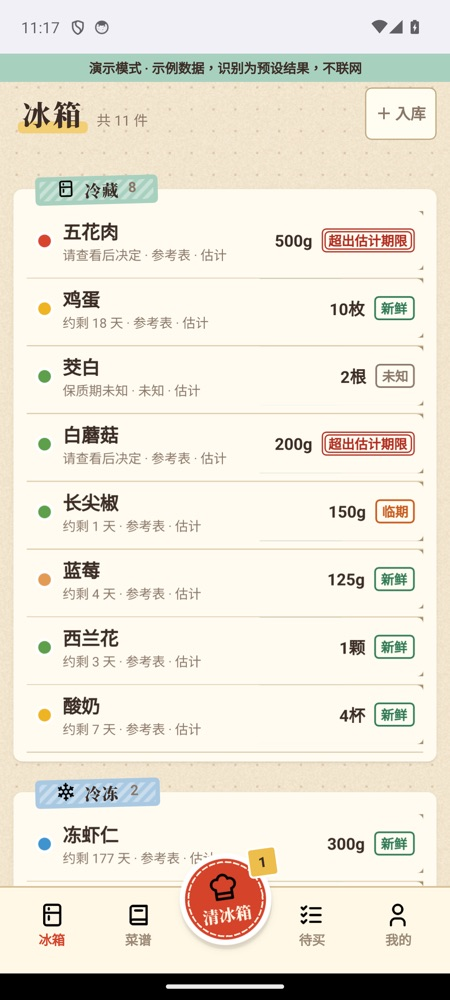
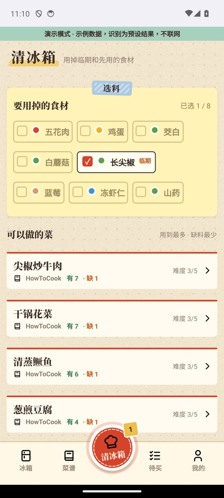
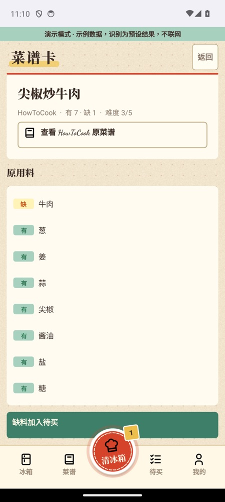

# 趁鲜 WhileFresh

一款帮家里**趁新鲜用掉已买食材**的 Android 应用。把买菜 App 的截图、订单文字或购物小票交给它，它会整理出冰箱里有什么、哪些该先用，再从有来源的菜谱里找出能做的菜，缺的料一键列进待买清单。

> **状态**：MVP 试用版 0.1.0 已完成，在 Android 模拟器上走通完整流程；arm64 真机尚未实测，正在进入测试迭代。未完成事项见 [docs/mvp/todo.md](docs/mvp/todo.md)。

<p>
  
  
  
</p>

<sub>截图来自演示模式，数据为示例。</sub>

## 功能

- **入库**：相册截图（可多张）、系统分享、拍购物小票、粘贴订单文字或手动添加。AI 识别商品、规格和截图上可见的生产日期，分出食材、调料和无关内容（推荐、凑单、配送费等），用户核对后才入冰箱。
- **冰箱**：按冷藏 / 冷冻 / 常温分区，每件食材显示新鲜 / 临期 / 超出估计期限，随日期自动变化。
- **保质期有依据**：取值优先级为 包装标注 > 你确认过的规则 > USDA FoodKeeper 参考表 > AI 估计，每项都标出来源；非包装标注的一律标"估计"，不给食品安全结论。
- **清冰箱做饭**：底栏中间的按钮。默认选中临期和标记先用的食材，从 372 道 [HowToCook](https://github.com/Anduin2017/HowToCook) 菜谱中按"用到所选最多、缺料最少"排序。
- **待买**：缺料按品类整理，可复制或分享。
- **常备规则**：盐、油、酱油、葱姜蒜等默认算家里有，可增删；系统的任何建议都需你确认。
- **演示模式**：内置示例数据与预设识别结果，不联网、不影响真实数据。
- **隐私**：数据只存在手机本机，不需要账号。识别前提示内容会发送到 DeepSeek。

## 技术栈

| 层 | 选型 |
| --- | --- |
| 客户端 | Qt 6.8.2（Qt Quick / QML + C++17），同一工程构建 Android APK 与 macOS 桌面开发版 |
| 本地存储 | SQLite（QtSql），带版本迁移 |
| 识别 | DeepSeek 多模态 API（`deepseek-flash`），长截图切片后识别；App 直连，无后端 |
| 内置数据 | HowToCook 菜谱、581 项标准食材词表、USDA FoodKeeper 保质期参考，由 Python 离线工具生成 |
| 网络 | KDAB android_openssl 提供 HTTPS |

## 快速开始

需要 macOS、Qt 6.8.2（含 Android 套件）、Android SDK / NDK 26、JDK 17、CMake、Ninja、uv。完整说明见 [docs/development.md](docs/development.md)。

```sh
scripts/fetch-deps.sh                      # 下载并固定 Android OpenSSL
scripts/build-desktop.sh                   # 桌面开发版
build/desktop/whilefresh                   # 运行
ctest --test-dir build/desktop             # C++ 测试
uv run --project tools pytest              # Python 工具测试

scripts/run-emulator.sh                    # 启动 Android 模拟器
scripts/build-android.sh x86_64            # 模拟器用 APK
scripts/install-android.sh x86_64          # 安装并启动
scripts/build-android.sh arm64-v8a --release   # 真机用签名 APK
```

识别需要 DeepSeek API 密钥。构建脚本从 macOS 钥匙串（条目 `landing-project-deepseek`）读取，生成到构建目录，不进仓库；没有密钥也能构建，App 会提示识别未配置，演示模式照常可用。

## 目录

```
app/       Qt 应用：src/{core,data,recognition,platform,ui}、qml/、android/、assets/、tests/
tools/     Python 离线工具：菜谱转换、词表、保质期参考表、合成测试数据
scripts/   构建、安装、模拟器脚本
test-data/ 合成样本、标准答案与识别录制
design/    HTML 视觉稿与设计参数
docs/      产品定义、MVP 过程文档、开发文档
```

各目录的放置规则见 [FHS.md](FHS.md)。

## 文档

| 文档 | 内容 |
| --- | --- |
| [PRD v6](docs/prd-v6.md) | 当前产品定义 |
| [MVP 需求](docs/mvp/mvp-requirements.md) | 功能范围与验收标准 |
| [MVP 规划](docs/mvp/mvp-plan.md) | 架构、技术决策、任务拆解 |
| [进度与决策](docs/mvp/cycle-state.md) | 已完成阶段与决策日志 |
| [审查记录](docs/mvp/review-log.md) | 每个功能分支的审查与处理 |
| [待办与已知问题](docs/mvp/todo.md) | 尚未完成的事项 |
| [试用版说明](docs/mvp/trial-release.md) | 安装、试用说明、已知限制 |
| [开发文档](docs/development.md) | 环境、命令、各模块说明 |
| [接入调研](docs/domestic-recipe-grocery-integration-research.md) | 菜谱与买菜平台数据来源调研 |
| [视觉稿](design/README.md) | 「厨房手账」设计参数 |
| [历史版本](docs/archive/README.md) | PRD v3、v4 与调研速查 |

协作规则见 [AGENTS.md](AGENTS.md)（Claude Code 经 `CLAUDE.md` 导入）。

## 许可

本项目代码采用 [BSD 3-Clause](LICENSE)。第三方内容：

- Qt 6.8.2 — LGPL v3（动态链接）
- OpenSSL 3（KDAB android_openssl）— Apache 2.0
- 菜谱 [HowToCook](https://github.com/Anduin2017/HowToCook) — Unlicense
- 保质期参考 [USDA FoodKeeper](https://catalog.data.gov/dataset/fsis-foodkeeper-data) — CC0
- 图标 [Tabler Icons](https://github.com/tabler/tabler-icons) — MIT
- 标题字体 Noto Serif SC — SIL OFL 1.1
